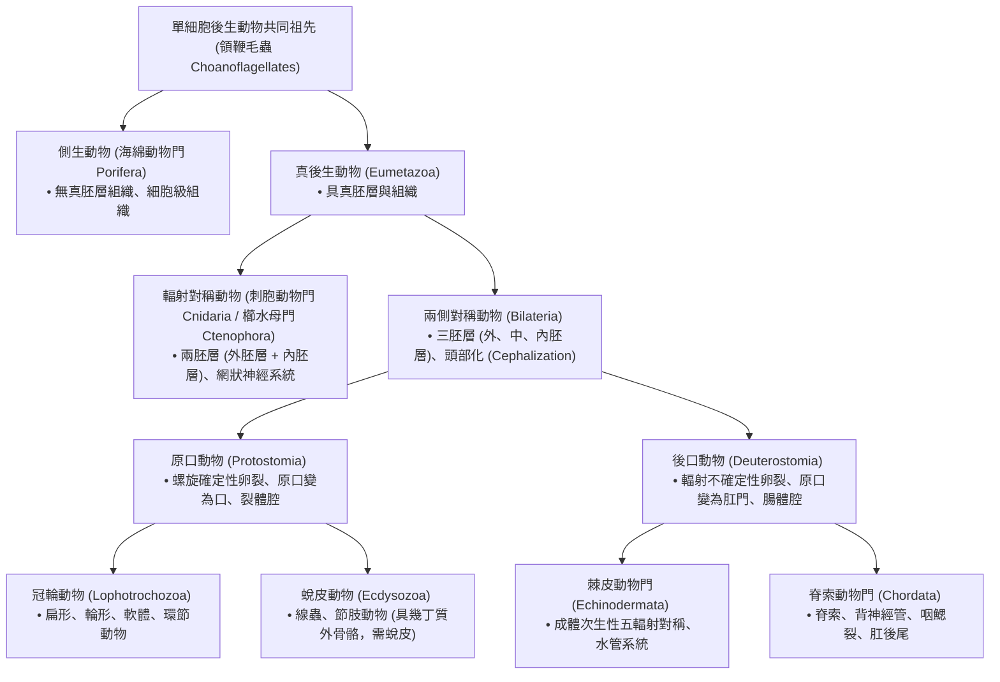

# 動物界各門演化樹與胚胎發育特徵比較

**典藏依據**：Hickman《Animal Diversity》& Miller-Harley《Zoology 5th Ed》
**核心定位**：為高中選修生物 III「動物的演化與多樣性」及生物奧林匹亞動物學大綱提供嚴謹的發育生物學與比較解剖學學理依據。

---

## 一、動物界胚胎發育五大關鍵演化分支

---

## 二、原口動物 (Protostomes) vs 後口動物 (Deuterostomes) 決定性比較

| 發育特徵項目 | 原口動物 (Protostomes) <small>冠輪動物、蛻皮動物（軟體、環節、節肢等）</small> | 後口動物 (Deuterostomes) <small>棘皮動物、半索動物、脊索動物</small> | 生物學與演化學意義 |
|---|---|---|---|
| **卵裂幾何排列** | **螺旋卵裂 (Spiral Cleavage)** 上下層卵裂球交錯排列在溝槽中 | **輻射卵裂 (Radial Cleavage)** 上下層卵裂球彼此直接垂直堆疊 | 早期有絲分裂紡錘體定向軸不同。 |
| **發育決定性** | **確定性卵裂 (Determinate Cleavage)** 早期各卵裂球命運已固定，若單獨分離無法發育為完整胚胎 | **不確定性卵裂 (Indeterminate Cleavage)** 早期各卵裂球保留發育全能性 (Totipotency) | **後口動物能產生同卵雙胞胎**，原口動物無法。 |
| **原口 (Blastopore) 命運** | **原口先發育成口** 後方穿孔發育為肛門（Proto = 第一，Stoma = 口） | **原口先發育成肛門** 對側凹陷形成次生口（Deutero = 第二） | 胚胎原腸腔穿通消化道方向倒轉。 |
| **中胚層起源與體腔形成** | **裂體腔法 (Schizocoely)** 原口兩側中胚層實體細胞團塊裂開形成腔室 | **腸體腔法 (Enterocoely)** 原腸腔內胚層壁向外突出囊泡，脫落癒合成體腔 | 中胚層來源不同：裂體腔源自 4d 胚裂球，腸體腔源自內胚層外凸。 |

---

## 三、動物界三大體腔類型演化

1. **無體腔動物 (Acoelomates)**：
   - *代表門類*：扁形動物門 (Platyhelminthes)。
   - *解剖特點*：消化道（內胚層）與體壁（外胚層）之間完全由實體的中胚層薄壁組織 (Parenchyma) 填滿，沒有任何游離體液腔。
2. **假體腔動物 (Pseudocoelomates)**：
   - *代表門類*：線形動物門 (Nematoda)、輪蟲動物門 (Rotifera)。
   - *解剖特點*：體腔僅由**外側的中胚層肌肉層**包裹，**內側緊鄰消化道處缺乏中胚層被膜**（即體腔源自胚胎囊胚腔的殘留，非完全由中胚層封閉）。
3. **真體腔動物 (Coelomates / Eucoelomates)**：
   - *代表門類*：軟體動物門、環節動物門、節肢動物門、棘皮動物門、脊索動物門。
   - *解剖特點*：體腔內外兩側**完全由中胚層衍生之體腔膜 (Peritoneum) 與腸繫膜完整包裹**，內臟器官懸掛固定於體腔內，提供腸道蠕動之緩衝空間與循環濾過微環境。
