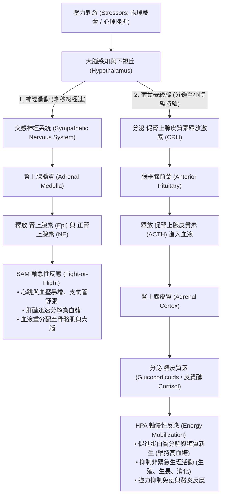

# 壓力反應神經內分泌路徑：SAM 軸 vs HPA 軸身心生理精解

**典藏依據**：Shelley E. Taylor《Health Psychology (10th Ed)》& Straub《A Biopsychosocial Approach》
**核心價值**：高中選修生物 II 分別介紹了自律神經系統（交感神經）、腎上腺髓質（腎上腺素）與腎上腺皮質（皮質醇）。本書將兩者無縫整合為身體對抗壓力的**「急性防衛戰線」**與**「慢性消耗戰線」**，為高中生理教學提供了極具系統性的全局視野。

---

## 一、身體抗壓力的兩大神經內分泌軸心

---

## 二、SAM 軸 vs HPA 軸核心特徵對比

| 比較項目 | SAM 軸 (交感-腎上腺髓質軸) | HPA 軸 (下視丘-垂體-腎上腺皮質軸) |
|---|---|---|
| **啟動途徑** | **神經傳導**（內臟大眼神經直接支配髓質嗜鉻細胞） | **內分泌體液途徑**（下視丘門脈系統 $\rightarrow$ 垂體 $\rightarrow$ 血液） |
| **反應時間** | **極速（數毫秒至數秒內發作）** | **較緩慢（數分鐘至數十分鐘達峰，持續數小時）** |
| **主要效應荷爾蒙** | **兒茶酚胺類 (Catecholamines)** 腎上腺素 (80%)、正腎上腺素 (20%) | **類固醇荷爾蒙 (Steroids)** 皮質醇 (Cortisol) / 氫化可的松 |
| **代謝效應** | 快速分解肝臟與肌肉肝醣，瞬間升高血糖與游離脂肪酸 | 促進骨骼肌蛋白質分解為胺基酸、加速肝臟**糖質新生 (Gluconeogenesis)**，提供長期抗壓能源 |
| **生理功能定位** | **戰鬥或逃跑 (Fight-or-Flight)** 應付突發物理威脅（如猛獸攻擊、車禍急剎） | **慢性適應與能量調度 (Coping & Conservation)** 應付長期饑荒、傷病、寒冷、失業或長期心理壓力 |

---

## 三、心理神經免疫學 (PNI) 與長期慢性壓力的生理代價

- **皮質醇的強效抗炎與免疫抑制機轉**：
  - 游離皮質醇為脂溶性類固醇，直接穿透靶細胞膜結合胞質糖皮質素受體 (GR)。
  - 活化的 GR 轉位進入細胞核，直接結合並抑制促炎關鍵轉錄因子 **NF-$\kappa$B**，徹底阻斷介白素 (IL-1, IL-6) 及腫瘤壞死因子 (TNF-$\alpha$) 等促炎細胞激素的轉錄。
  - 同時誘導 T 細胞凋亡、抑制嗜中性球從血管向組織外滲，臨床上作為強效抗過敏、抗自體免疫與器官移植抗排斥藥物。
- **異體負荷 (Allostatic Load) 與慢性身心疾病**：
  - 當壓力長期不退，HPA 軸持續過度激活用，引發嚴重的身心病理：
    1. **免疫抑制**：自然殺手細胞 (NK cells) 活性下降、疫苗抗體反應低落、帶狀疱疹等潛伏病毒復發。
    2. **海馬迴神經元毒性**：海馬迴是 HPA 軸負回饋的核心中樞，長期高濃度皮質醇會造成海馬迴樹突萎縮與神經退化，引發記憶力顯著衰退與憂鬱症。
    3. **代謝症候群**：慢性高皮質醇引發向心性肥胖（脂肪囤積於腹部與頸部水牛肩）、胰島素阻抗與動脈粥狀硬化。
